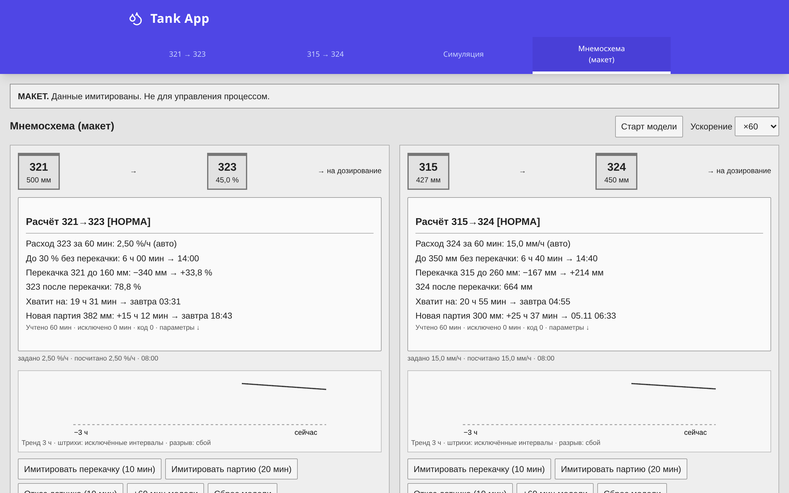
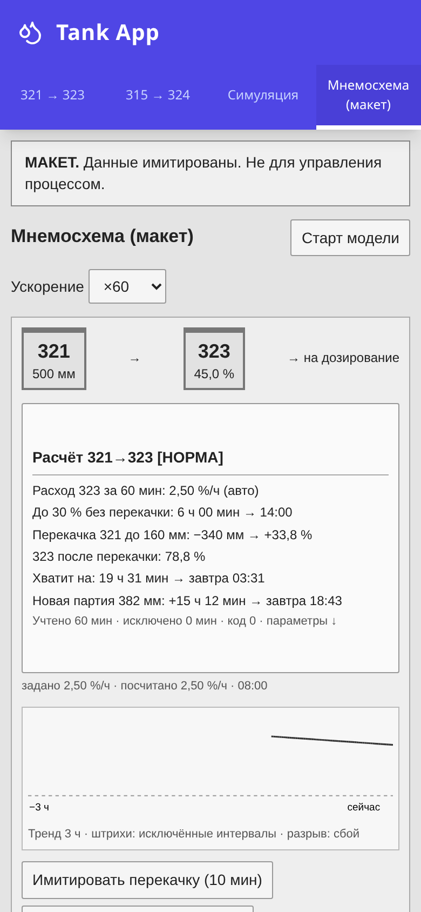

# Автоматический расчёт запаса раствора на мнемосхеме

Пояснительная записка к улучшению малыми шагами. Связки 321→323 и 315→324.
Материал для рассмотрения; приведённые экраны — макет с имитированными данными.

## Проблема

На мнемосхеме не видны расход раствора из 323 и 324 и время до неснижаемого
остатка. Оператор снимает уровень, через час повторяет замер, вручную учитывает
перекачку, пересчитывает единицы и прогнозирует запас. Это занимает `[__]` мин
за смену; при разных подходах смен возможны ошибки. Если перекачку или
приготовление выполнить поздно, возникает риск снижения уровня ниже остатка
и нарушения дозирования; работы с перекисями приходится выполнять в спешке.

## Решение

Разместить два информационных блока у ёмкостей 321 и 315: автоматический расход
за 60 минут, прогноз без перекачки, после расчётной перекачки до выбранного
уровня и для новой партии. Интервалы перекачки и сбоя датчика исключаются из
расчёта расхода. Предусмотрены индикация «Внимание» и «Срочно», пояснение причин
отсутствия прогноза и проверка перелива при заданном максимуме расходной ёмкости.

## Как выглядит

Макет: 03.11.2026, 08:00, шум отключён для воспроизведения контрольных примеров.
На ПК блоки рядом; на мобильном экране — последовательно. Снимки сделаны из
прототипа, они не являются экранами реальной АСУ ТП.

## Алгоритм коротко

Раз в минуту сохраняются уровень и качество. Для пригодных участков часового
окна суммируются убыль уровня и длительность. Расход равен их отношению.
Из запаса вычитается неснижаемый остаток; деление на расход даёт время работы.
При недостатке пригодных данных допускается ограниченное удержание последнего
расхода с указанием возраста; при плохом текущем датчике прогноз не строится.
Коэффициенты перекачки сохранены из калькулятора автора; подготовлены тесты,
контрольные CSV и функциональный блок на ST для проверки службой АСУ ТП.

## Ожидаемый эффект

Единый расчёт для всех смен снижает вероятность ошибок и помогает планировать
приготовление и перекачку без спешки, поддерживать надёжное дозирование и
учитывать риск перелива. Фактический расход и его отклонения становятся видны
сразу после накопления данных. Ожидаемая экономия времени оператора — `[__]`;
подтверждается замером до и после внедрения. Количественный эффект — УТОЧНИТЬ.

## Затраты

Предполагается программная доработка силами службы АСУ ТП без нового
оборудования: `[__]` чел.-ч. Трудоёмкость и стоимость `[__]` — УТОЧНИТЬ после
выбора места расчёта и оценки доступа к истории и качеству сигналов.

## Безопасность

Расчёт только информационный. Он не управляет оборудованием, не формирует
технологическую сигнализацию, не меняет блокировки и ПАЗ, не заменяет регламент
и инструкции. Цветовые подсказки — без звука и журнала тревог. Прототип
не подключается к реальным системам и не устанавливается на станции АСУ ТП.
Внедрение выполняется по действующей процедуре управления изменениями.

## Что нужно от службы АСУ ТП

УТОЧНИТЬ роли ёмкостей и сигналы перекачки; максимумы 323, 324 и 315; качество
и инженерные единицы датчиков; характерные расходы и рост при перекачке;
пороги расхода и индикации; пригодность окна 60 минут. Выбрать платформу и место
расчёта (контроллер, сервер или архив), привязать условные имена к сигналам,
согласовать время экрана и проверить ST на контрольных примерах. Отдельно
уточнить фактическое время приготовления партии для возможного развития.
Полный перечень — в отчёте `docs/REPORT_CODEX.md`.

Дополнительный мобильный снимок 315→324: [изображение](img/mnemo-390x844-pair315@2x.png).
